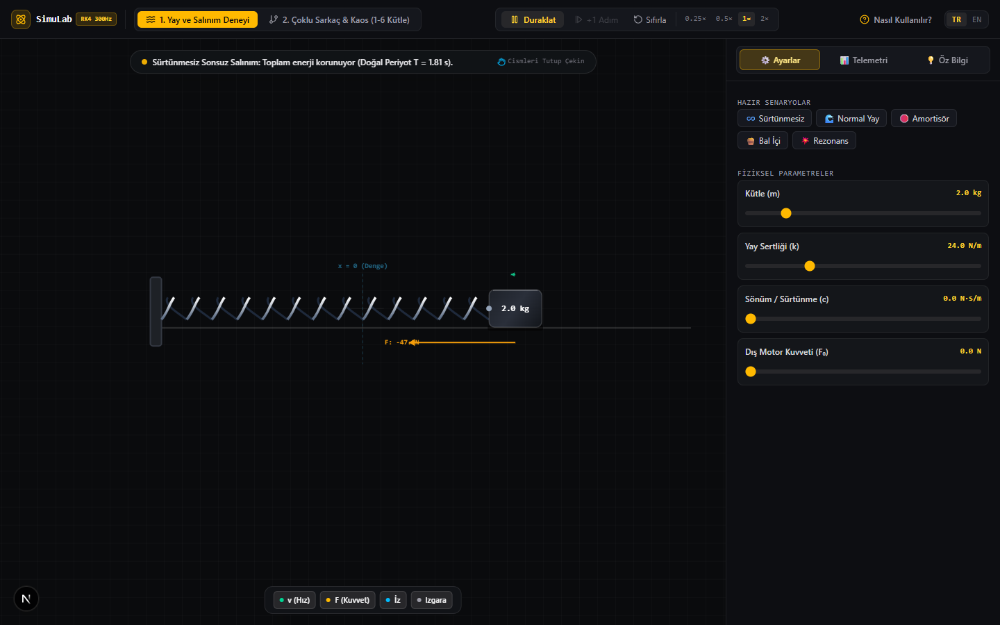

# SimuLab — RK4 Physics Studio & Inspector

**SimuLab**, klasik mekanik, doğrusal olmayan salınımlar, 1'den 6'ya çoklu sarkaç zincirleri ve kaos teorisini **Figma / Linear estetiğinde bir Precision Instrument & Inspector** arayüzüyle sunan interaktif hesaplamalı fizik laboratuvarıdır.



## 🔬 Temel Özellikler

1. **4. Dereceden Runge-Kutta (RK4) Sayısal Çözücü (`src/engine/rk4.ts`)**
   - Basit Euler yerine $300\text{ Hz}$ mikro-adımlarla çözülen yüksek hassasiyetli 4. Dereceden Runge-Kutta diferansiyel denklem çözücüsü.
   - Sönüm ve sürtünme kaynaklı termal kayıplar ($E_{\text{thermal}} = \int P_{\text{dissipated}}\,dt$) anlık hesaplanarak mekanik enerji dengesi canlı doğrulanır.

2. **İnteraktif Modüller & Doğrudan Manipülasyon:**
   - **Yay-Kütle Osilatörü (Harmonic Oscillator):** Doğal frekans ($\omega_0$), sönüm oranı ($\zeta$), sönümlü frekans ($\omega_d$) ve periyot analizleri. Eksik sönümlü spiral, kritik sönümlü doğrudan sönme ve aşırı sönümlü rejimlerin canlı gözlemi.
   - **Çoklu Sarkaç & Kaos (1-6 Kütleli Sarkaç Zincirleri):** Tek sarkaçtan 6 kütleye kadar bağlanabilir sarkaç zinciri. Tam doğrusal olmayan hareket denklemleri, $\Delta\theta = 0.001\text{ rad}$ farkla ayrışan **Gölge Sarkaç (Ghost Pendulum)** ve Kelebek Etkisi / Lyapunov ayrışması.

3. **Canlı Telemetri & Bilimsel Grafikler:**
   - **Faz Uzayı Osiloskopu (Phase Space Oscilloscope):** Konum ($x, \theta$) ile Hız ($\dot{x}, \omega$) arasındaki yörüngeyi anlık çizen, kapalı limit çevrimleri ve kaotik çekicileri canlı yorumlayan osiloskop.
   - **Dinamik Enerji Korunumu Çubukları:** Kinetik ($E_k$), Potansiyel ($E_p$) ve Termal Isı ($E_{\text{thermal}}$) dengesi.
   - **Vektör Katmanları:** Canlı hız ($\vec{v}$) ve net ivme/kuvvet ($\vec{F}_{\text{net}}$) vektörleri.

## 🛠️ Teknolojiler

- **Framework:** Next.js (App Router), React 19, TypeScript
- **Stil & Tasarım:** Tailwind CSS, Lucide Icons, KaTeX
- **Görselleştirme:** HTML5 2D Canvas (3D Volumetrik Gölgelendirme & Metalik Yansımalar)
- **Fizik:** Özel 4. Dereceden Runge-Kutta (RK4) İntegratörü

## 🚀 Kurulum ve Çalıştırma

```bash
npm install
npm run dev
```

Üretim derlemesi:
```bash
npm run build
npm start
```
