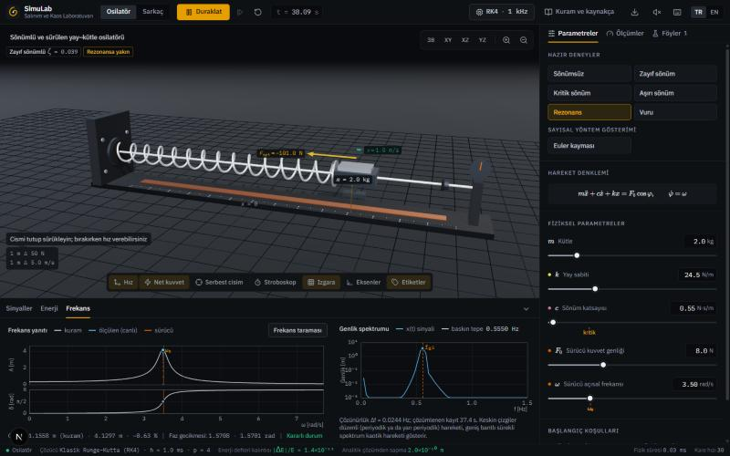
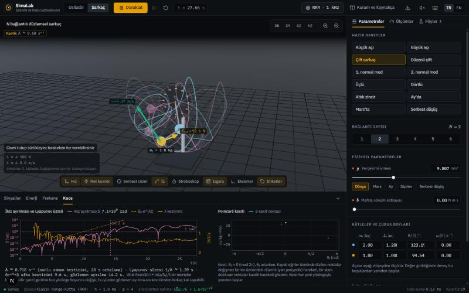

# SimuLab — Salınım ve Kaos Laboratuvarı

Tarayıcıda çalışan, **doğrulanmış** bir hesaplamalı fizik laboratuvarı. Gördüğünüz her hareket, hareket denklemlerinin sayısal çözümüdür; her büyüklük sanal cihazlarla ölçülüp kuramla karşılaştırılabilir ve sayısal hata çalışma boyunca ekranda yazar.

> English summary: an interactive, verified computational-physics laboratory (Next.js, React, three.js) for a damped driven oscillator and a planar N-link pendulum, with a fixed-step solver, an always-on energy ledger, Lyapunov-exponent estimation, Poincaré sections, measurement-based task sheets and a bilingual technical report. See [docs/TECHNICAL_REPORT.md](docs/TECHNICAL_REPORT.md).




## Deneyler

| | Osilatör | Sarkaç |
| --- | --- | --- |
| Model | $m\ddot x + c\dot x + kx = F_0\cos\varphi,\ \dot\varphi=\omega$; rijit durdurucular (Newton geri sıçrama katsayısı) | $N = 1\dots6$ noktasal kütle, kütlesiz rijit çubuklar; mafsallarda viskoz sönüm |
| Çözüm | Sabit adımlı RK4 (varsayılan $h = 1$ ms); Euler, yarı örtük Euler, RK2 ve uyarlamalı Dormand–Prince 5(4) seçilebilir | Aynı çözücüler; kütle matrisi Cholesky ayrışımıyla çözülür |
| Karşılaştırma | Kapalı biçimli çözüm aynı grafikte; genlik ve faz yanıtı eğrileri; sayısal frekans taraması | Eliptik integralle tam periyot; normal mod frekansları; Laguerre/Bessel spektrumu |
| Kaos | — | İkiz yörünge, Benettin yöntemiyle en büyük Lyapunov üsteli, Poincaré kesiti, spektrum |

Ortak araçlar: enerji defteri ($E_k + E_p + Q - W = E_0$ ve kalıntısı), ölçekli serbest cisim diyagramı, stroboskop, zaman serisi ve faz portresi, genlik spektrumu, ölçüme dayalı dokuz deney föyü, üstverili CSV dışa aktarımı, yeniden üretilebilir deney dosyası ve paylaşım bağlantısı, Türkçe/İngilizce arayüz.

## Doğrulama

Çözücü, yanıtı bağımsız olarak bilinen problemlerle sınanır. Varsayılan çözücüyle (RK4, 1000 Hz) geliştirme makinesinde ölçülen değerlerden bazıları:

| Deney | Ölçülen | Bağımsız başvuru |
| --- | --- | --- |
| RK4 gözlenen yakınsama mertebesi | 4,005 | 4 |
| Serbest yanıt, dört sönüm rejimi, 20 s, en büyük konum hatası | $1{,}6\times10^{-10}$ m | kapalı biçimli çözüm |
| Sürülen kararlı durum genliği, en büyük bağıl hata | $3{,}3\times10^{-8}$ | $A(\omega)$ |
| Durdurucuya çarpma anı | $8{,}6\times10^{-13}$ s hata | analitik $t = \arccos(x_\min/x_0)/\omega_0$ |
| Sürülen, sönümlü, 27 çarpışmalı 60 s: defter kalıntısı | $1{,}3\times10^{-12}$ | 0 |
| Sarkaç periyodu, $\theta_0 = 10^\circ\dots170^\circ$ ve dönme, bağıl hata | $\le 2{,}4\times10^{-10}$ | $4\sqrt{L/g}\,K(\sin\tfrac{\theta_0}{2})$ |
| Çift sarkaç, 60 s bağıl enerji sapması | $2{,}0\times10^{-9}$ | 0 |
| Eşit bağlantılı zincir özdeğerleri | $8\times10^{-16}$ bağıl | Laguerre polinomunun sıfırları |
| Lagrange ↔ Newton tutarlılığı (çubuğa dik kuvvet / gerilme) | $5\times10^{-15}$ | 0 |

Hepsini kendi makinenizde yeniden üretebilirsiniz:

```bash
npm test
```

```bash
npm run docs
```

İkinci komut [docs/VALIDATION.md](docs/VALIDATION.md) ile teknik raporu yeniden üretir. Aynı paket uygulamanın içinden de çalıştırılır: **Kuram ve kaynakça → Doğrulama**.

## Belgeler

- [docs/TEKNIK_RAPOR.md](docs/TEKNIK_RAPOR.md) — kuram, sayısal yöntemler, doğrulama, tasarım gerekçeleri, yaygın yanılgılar, sınırlılıklar ve kaynakça (Türkçe).
- [docs/TECHNICAL_REPORT.md](docs/TECHNICAL_REPORT.md) — aynı raporun İngilizcesi.
- [docs/VALIDATION.md](docs/VALIDATION.md) — on dört doğrulama deneyinin ölçülen değerleri.

Rapor, uygulama içindeki kuram metniyle tek kaynaktan üretilir (`src/content/theory`); aynı metin uygulamada **Kuram ve kaynakça** (`K` tuşu) altında içindekiler, numaralı denklemler ve tıklanabilir atıflarla okunur. Kaynak veritabanındaki 184 kaydın her biri birincil kaynağından doğrulanmıştır (`src/content/references.ts`); metin bunların 147'sine atıf yapar. Kuram metni yalnızca olumlu sonuçları değil, modelin varsayımlarını, yapılmamış çalışmaları (fiziksel düzenekle geçerleme, kullanıcı çalışması) ve sık yinelenen yanılgıların kaynaklı düzeltmelerini de içerir.

## Çalıştırma

Node.js 22.12 ya da üstü gerekir.

```bash
npm install
```

```bash
npm run dev
```

Üretim derlemesi:

```bash
npm run build
```

```bash
npm start
```

Yayımlarken `NEXT_PUBLIC_SITE_URL` ortam değişkenine sitenin adresi verilirse paylaşım önizlemelerindeki görsel mutlak adresle sunulur (Vercel'de gerekmez).

| Komut | İşlev |
| --- | --- |
| `npm run dev` | Geliştirme sunucusu |
| `npm run build` | Üretim derlemesi |
| `npm test` | Birim sınamaları, doğrulama paketi ve içerik tutarlılığı (153 sınama) |
| `npm run typecheck` | TypeScript tür denetimi |
| `npm run lint` | ESLint |
| `npm run check` | Tür denetimi, lint ve sınamalar |
| `npm run docs` | Raporları ve doğrulama çizelgelerini yeniden üretir |

## Yapı

```
src/
  physics/   Çerçeveden bağımsız fizik: integratörler, osilatör, N-sarkaç, Lyapunov,
             ölçüm cihazları, spektrum, özel fonksiyonlar, doğrulama deneyleri
  sim/       Çalışma zamanı: sabit adımlı döngü, telemetri tamponları, ön ayarlar,
             deney föyleri, CSV/JSON/bağlantı alışverişi
  scene/     three.js sahnesi: düzenekler, ölçekli vektörler, doğrudan manipülasyon
  ui/        React arayüzü: kabuk, denetçi, grafikler, kuram okuyucu, bileşen seti
  content/   Kuram metni (TR/EN), föy içerikleri, atıf biçimleme ve doğrulanmış kaynakça
  i18n/      Arayüz sözlükleri (Türkçe kaynak; İngilizce tür denetimli)
  audio/     Sonifikasyon
tests/       Birim sınamaları, çalışma zamanı sınamaları, doğrulama paketi, içerik tutarlılığı
scripts/     Belge üreticileri
docs/        Üretilen raporlar
```

Sürekli durum React dışında tutulur; sahne ve grafikler her karede çalışma zamanından doğrudan okur. Zaman adımı sabittir, bu yüzden aynı başlangıç koşulları ekran yenileme hızından bağımsız olarak aynı yörüngeyi verir.

## Klavye

| Tuş | İşlev | Tuş | İşlev |
| --- | --- | --- | --- |
| `Space` | Çalıştır / duraklat | `V` | Hız vektörü |
| `.` | Bir kare ilerlet | `F` | Net kuvvet |
| `R` | Başlangıç koşullarına dön | `B` | Serbest cisim diyagramı |
| `1` / `2` | Osilatör / sarkaç | `T` | İz |
| `D` | Grafik paneli | `S` | Stroboskop |
| `K` | Kuram ve kaynakça | `G` | Izgara |
| `M` | Ses | `?` | Kısayollar |
| Ok tuşları | Kamerayı döndür (sahne odaktayken) | `Shift` + ok tuşları | Kamerayı kaydır (sahne odaktayken) |

Harf, rakam ve noktalama tuşlarıyla verilen tek tuşlu kısayollar, kısayollar penceresindeki anahtarla kapatılabilir; boşluk tuşu çalışmayı sürdürür. Bir iletişim kutusu, menü ya da liste açıkken, bir alana yazı yazılırken ve bir cisim tutulurken kısayollar işlem yapmaz. Vektörlerin çizildiği sarkaç kütlesi, sahnedeki vektör ölçeğinin yanında duran seçiciyle klavyeden de belirlenir.

## Sınırlılıklar

- Model idealdir: noktasal kütleler, kütlesiz rijit çubuklar, düzlemsel hareket, kütlesiz ve doğrusal yay, hızla orantılı sönüm, sabit geri sıçrama katsayılı rijit durdurucular.
- Doğrulama, denklemlerin doğru çözüldüğünü gösterir; ideal modelin gerçek bir düzenekle uyumunu sınamaz.
- Açık, sabit adımlı yöntemlerde hata adım büyüklüğüne bağlıdır. Durum çubuğu enerji defteri kalıntısını sayıyla ve renkle gösterir; bağıl kalıntı $10^{-5}$ değerine ulaştığında uyarlamalı çözücüyle yeniden başlatmayı önerir. Yöntemin ya da adım frekansının değiştirilmesi iki deneyi de başlangıç koşullarından yeniden başlatır; böylece her kayıt tek bir çözücüye aittir.
- Düşük mertebeli bir yöntem ve iri bir adımla çözüm ıraksayabilir. Durum değişkenleri sonlu aralıktan çıktığında deney durdurulur ve son geçerli durum ekranda kalır.
- Gerçek zaman güvencesi yoktur: 0,1 s'den uzun süren bir karenin 0,1 s'yi aşan bölümü benzetime aktarılmaz, benzetim zamanı duvar saatinin gerisinde kalır; durum çubuğu bu kareleri sayar.
- Saat ile analitik çözümü gösteren anahtar yalnızca 768 piksel ve üzerindeki pencere genişliklerinde görünür. Zaman ölçeği üst çubukta 1536 pikselden başlayarak, daha dar pencerelerde parametre panelinin başında ayarlanır.
- Lyapunov üsteli ve öngörü ufku sonlu zaman kestirimleridir.
- Laboratuvarın öğrenmeye etkisi ölçülmemiştir.
